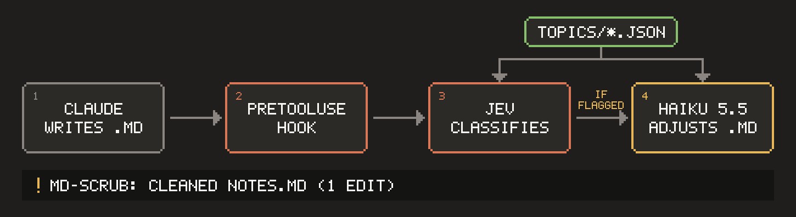

# md-scrub

[](https://code.claude.com/docs/en/plugins/install) [](https://github.com/macp-sh/md-scrub/releases/latest) [](LICENSE)

**A Claude Code plugin that enforces what Claude writes in Markdown.**



Claude Code writes a lot of Markdown. You can tell Claude what never to put in it, and it will follow that most of the time, but not every time. md-scrub enforces it: it checks the Markdown Claude writes before it's saved and removes anything you've ruled out.

## Install

You'll need Claude Code v2.1.287 or later on macOS or Linux, [Bun](https://bun.sh), and an [OpenRouter](https://openrouter.ai) API key. Checking costs a fraction of a cent per file.

Inside a Claude Code session, run:

```
/plugin install md-scrub --marketplace macp-sh/claude-plugins
```

Claude Code asks for an OpenRouter key for Jev when the plugin is enabled. If you installed from a shell, or want to change the key later, open `/plugin`, go to Installed, select md-scrub and choose Configure; until a key is set, md-scrub stays off and the status line says so. To get updates automatically, open `/plugin`, go to Marketplaces, select `macp-sh` and choose Enable auto-update. To remove md-scrub, run `claude plugin uninstall md-scrub@macp-sh`.

## What it does

- **Removes unwanted content** from Markdown that Claude writes or edits, and tells Claude what changed.
- **Blocks whole documents** that are mostly unwanted content, such as a saved terms of service page.
- **Checks files written by commands and scripts** at the end of each turn.
- **Leaves alone** files you edit yourself, and licence files such as `LICENSE` and `NOTICE`.

md-scrub ships with one example topic, `third-party-terms`, which stops Claude writing **third-party legal terms** into `.md` files: what another company's terms of service, licence or policy says you can or can't do. Your own project's licence, and mentions like "zod (MIT)", are left alone.

## Add your own topics

A topic is a JSON file describing content to keep out, such as credentials and tokens, customer or personal data, internal hostnames, or unreleased product names.

Topics live in a `topics` folder and are layered like Claude Code's own settings: the built-in topic, then yours in `~/.config/md-scrub/topics/` (every project), then a project's in `.md-scrub/topics/`, with the more specific one winning. The file name is the topic's id, as used in `config.json`. For example, `credentials.json`:

```json
{
  "name": "credentials",
  "description": "API keys, passwords, tokens and private keys.",
  "examples": {
    "is": ["API_TOKEN=tok_8f2k9x7q..."],
    "isNot": ["Put your key in .env"]
  }
}
```

`is` lists examples to remove and `isNot` examples to keep. A few of each makes the topic more accurate. The built-in topic, [`third-party-terms.json`](defaults/topics/third-party-terms.json), shows every field.

## How it works

1. **A PreToolUse hook** catches every Markdown write from Claude's Write and Edit tools before it's saved, so the check can't be skipped. A Stop hook checks files that commands and scripts wrote at the end of each turn.
2. **[Jev](https://docs.typesafe.ai)**, a fast classifier reached through OpenRouter, scores the new text against your topics. Most writes stop here and are saved as written.
3. **Claude Haiku 5.5** runs only when Jev flags something. It runs through `claude -p` (Claude Code's headless mode) with your existing login, so there's no Anthropic API key to set up, and proposes the smallest edits that remove the flagged text. md-scrub accepts edits that only delete text, then has Jev check the result again.
4. **A Claude Code mod** shows what md-scrub changed in the status line.

## Turn it off or skip files

All of these go in a `.md-scrub/` folder at the top of your project.

| To | File | Contents |
| :- | :- | :- |
| Switch md-scrub off in this project | `config.json` | `{ "enabled": false }` |
| Turn off the built-in topic, keep your own | `config.json` | `{ "topics": { "third-party-terms": { "enabled": false } } }` |
| Skip files or folders | `ignore` | One per line, such as `legal/` or `docs/privacy.md` |

## Privacy and cost

The Markdown Claude writes is checked by the [Jev](https://docs.typesafe.ai) classifier (run by TypeSafe) through OpenRouter. Text that needs removing is also sent to Claude Haiku through your own Claude Code account. md-scrub's own log keeps scores and costs, never your text.

Checking costs a fraction of a cent per file. Removing something adds a few seconds.

## Licence

MIT. See [LICENSE](LICENSE).
